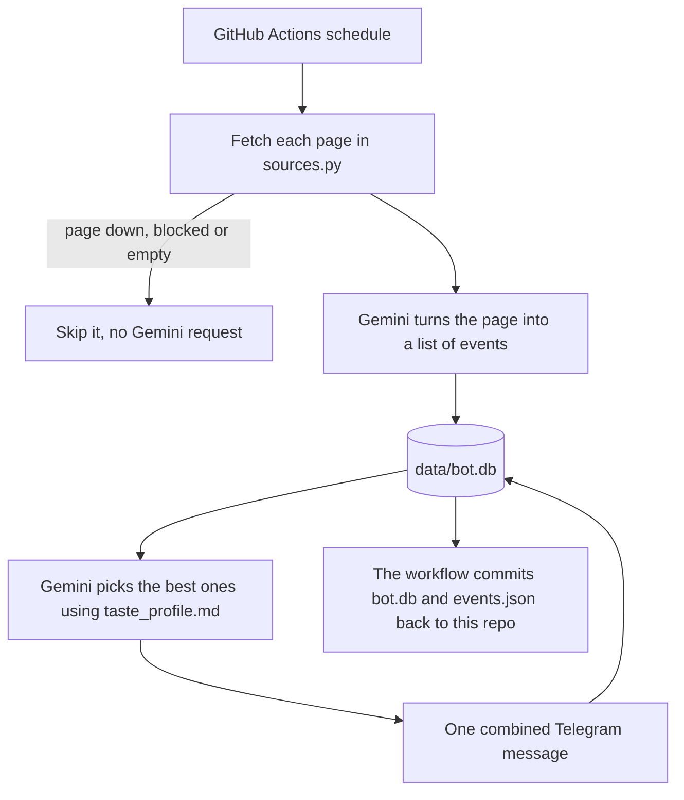
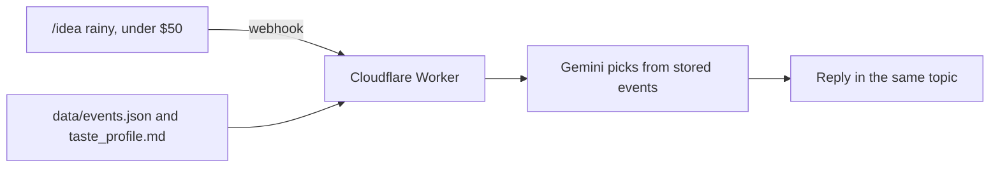

# LePain date ideas generator 💕

A Telegram bot that finds Singapore date ideas (events, live music, food happenings), picks the ones that suit us, and posts them into the **Date Ideas** topic of our group.

It costs nothing to run. GitHub Actions wakes it up on a schedule, Google Gemini's free tier reads the event pages and chooses the picks, and a small SQLite file in this repo is its memory. A free Cloudflare Worker answers the `/idea` command.

## What it posts

| Job | When (SGT) | What you see in the group |
|---|---|---|
| `monthly` | 25th, 7pm | One message with the top 10–15 picks for **next** month |
| `weekly` | Mondays, 7pm | One message with up to 5 newly found picks, or "nothing new this week". Skipped on the 25th |
| `daily` | 9am | Usually nothing. Posts one 🎟️ message when tickets are about to go on sale for an event in a later month |
| `status` | Only when you run it | A summary of the database and today's Gemini usage |
| `/idea` | When you type it in the group | Up to 5 stored events that fit what you asked for |

A monthly or weekly post looks like this, and each one is a single notification:

```
📆 Date ideas for December 2026

1. Laufey: A Matter of Time
    Sat 5 Dec, 8pm · Details
2. Hawker Feast Festival
    12–14 Dec · Details
```

The weekly job looks at the current month, plus next month from the 25th onward.

## How it works



`/idea` works separately, on Cloudflare:



| File | What it does |
|---|---|
| `bot/__main__.py` | Command line entry point |
| `bot/jobs.py` | The `monthly`, `weekly`, `daily` and `status` jobs, plus scraping and collecting reactions |
| `bot/sources.py` | The list of pages to read |
| `bot/scrape.py` | Downloads a page and reduces it to compact text, keeping links and any structured event data |
| `bot/llm.py` | Gemini requests: extracting events, ranking them, retries and backup models |
| `bot/db.py` | SQLite storage |
| `bot/formatting.py` | Builds the Telegram messages |
| `bot/telegram.py` | Small Telegram Bot API client |
| `bot/config.py` | Settings such as how many picks to post |
| `taste_profile.md` | What we like, in plain English |
| `worker/` | The Cloudflare Worker that answers `/idea` (JavaScript) |
| `data/events.json` | Upcoming events, exported after each job for the Worker |
| `.github/workflows/bot.yml` | The schedule and manual run options |

The database has five tables: `events`, `reactions`, `alerts` (ticket alerts already sent), `gemini_usage` (requests per model per day) and `meta` (small bits of saved state).

## Setup

1. **Add the bot to the group and make it an admin** (Group → Manage → Administrators → add `@lepain_date_ideas_generator_bot`). No special rights are needed. Being an admin lets it see commands like `/idea`.

2. **Install it on your Mac and find the group and topic IDs.** In the *Date Ideas* topic, send `/start@lepain_date_ideas_generator_bot`. Then run:

   ```bash
   python3 -m venv .venv && source .venv/bin/activate
   pip install -r requirements.txt
   TELEGRAM_BOT_TOKEN='<token from BotFather>' python -m bot discover
   ```

   Note the `chat_id` (starts with `-100`) and the `thread_id` printed for your `/start` message.

3. **Get a free Gemini API key** at <https://aistudio.google.com/apikey>.

4. **Add the repo secrets** under GitHub → Settings → Secrets and variables → Actions:

   | Secret | Value |
   |---|---|
   | `TELEGRAM_BOT_TOKEN` | From BotFather |
   | `TELEGRAM_CHAT_ID` | e.g. `-1001234567890` |
   | `TELEGRAM_THREAD_ID` | The Date Ideas topic ID. If it's blank, posts won't go to that topic |
   | `GEMINI_API_KEY` | From AI Studio |

   Optional: under the *Variables* tab, set `GEMINI_MODEL` to pin a model. The default is `gemini-flash-latest`.

5. **Test with a dry run.** Go to Actions → *date-ideas-bot* → *Run workflow*, choose job `monthly`, leave dry run ticked, and enter a month such as `2026-11`. The messages it *would* post appear in the run log.

6. **Go live.** Run the same thing with dry run **unticked**. After that, the schedule takes over.

## Everyday use

### Run a job by hand

Go to Actions → *date-ideas-bot* → *Run workflow*.

- **Dry run is ticked by default.** Untick it to actually post.
- **Month** only applies to `monthly`. Leave it blank for next month.
- **`status`** always posts, even with dry run ticked, and makes no Gemini requests. It shows something like this:

  ```
  📊 Bot status, Mon 9 Nov
  🗂️ Events stored: 65
  ✅ Posted: 13
  ⏭️ Considered, not picked: 37
  ⏳ Not considered yet: 15
  💬 Reactions saved: 0 (👍 0 · 👎 0)
  🎟️ Ticket alerts sent: 0

  🤖 Gemini requests today (resets 4pm SGT)
  • gemini-3.8-flash: 2 of 20 used (0 failed)
  ```

Only one run happens at a time, so a run you start may wait for one already in progress.

### Pause the bot

Go to Actions → *date-ideas-bot* → `…` → **Disable workflow**, and use the same menu to turn it back on. Manual runs are also off while it's disabled. From the command line, use `gh workflow disable bot.yml` and `gh workflow enable bot.yml`.

### Ask for an idea

In the group, type `/idea` with whatever you're in the mood for, or on its own for general suggestions:

```
/idea rainy, under $50, tonight
/idea live music this weekend
/idea
```

It only chooses from events the bot has already stored, usually refreshed that morning. It doesn't search the web live, and it only answers in our group.

### Look inside the database

```bash
git pull
sqlite3 -header -column data/bot.db "select title, start_date, posted_at from events order by start_date;"
```

### Change what it picks

| To change | Edit |
|---|---|
| What we like and don't like | `taste_profile.md`, in plain English |
| Which websites it reads | `bot/sources.py` |
| Number of picks, how far ahead to track events | `bot/config.py` |

A source page has to show its events without JavaScript. URLs can use `{month_name}`, `{month_num}` and `{year}`, but each extra month then costs another Gemini request.

## Set up /idea

Only needed once, and only after the code without `getUpdates` is live on GitHub.

1. Create a free account at <https://cloudflare.com>, then run `npx wrangler login`.
2. Add the secrets. Each command asks for a value:

   ```bash
   cd worker
   npx wrangler secret put TELEGRAM_BOT_TOKEN --name lepain-date-ideas
   npx wrangler secret put GEMINI_API_KEY --name lepain-date-ideas
   npx wrangler secret put TELEGRAM_CHAT_ID --name lepain-date-ideas
   openssl rand -hex 32                                                  # generates the value for the next one
   npx wrangler secret put TELEGRAM_WEBHOOK_SECRET --name lepain-date-ideas
   ```

3. Deploy with `npx wrangler deploy`, and note the `https://lepain-date-ideas.<something>.workers.dev` address it prints.
4. Connect Telegram, using the same random value as `TELEGRAM_WEBHOOK_SECRET`:

   ```bash
   curl https://api.telegram.org/bot<BOT_TOKEN>/setWebhook \
     -d url=<WORKER_ADDRESS> -d secret_token=<WEBHOOK_SECRET> \
     --data-urlencode 'allowed_updates=["message"]' -d drop_pending_updates=true
   ```

To turn `/idea` off, call `https://api.telegram.org/bot<BOT_TOKEN>/deleteWebhook`. After changing anything in `worker/`, run `npx wrangler deploy` again from that folder, because pushing to GitHub doesn't update Cloudflare. To test the Worker, run `node --test` in `worker/`.

## Run it locally

```bash
source .venv/bin/activate
export GEMINI_API_KEY=...            # Telegram variables aren't needed for --dry-run
python -m bot monthly --dry-run --month 2026-12
python -m bot weekly --dry-run --today 2026-11-30
python -m bot status --dry-run       # no Gemini key needed

pip install pytest                   # only needed once
pytest -q
```

| Environment variable | Needed for |
|---|---|
| `GEMINI_API_KEY` | Every job except `status` and `discover` |
| `TELEGRAM_BOT_TOKEN`, `TELEGRAM_CHAT_ID` | Anything that really posts |
| `TELEGRAM_THREAD_ID` | Posting into the right topic |
| `GEMINI_MODEL` | Optional, picks a different model |
| `BOT_DB_PATH` | Optional, uses a different database file |

## Gemini limits

The free tier allowed **20 requests per day per model** for `gemini-3.8-flash` when we last hit the limit. It resets at midnight Pacific time, which is 4pm SGT in winter and 3pm SGT during US daylight saving.

- Each source costs 1 request and each ranking costs 1. With 5 sources, a normal day uses about 5.
- Each `/idea` costs 1 request on Flash-Lite, so it doesn't eat into the digests' quota. It only falls back to the main Flash model if Flash-Lite fails.
- A source that succeeded today is remembered and skipped. The evening `weekly` or `monthly` job reuses the morning's scrape, and a rerun only retries what failed.
- Google has no way to look up remaining quota, so `status` shows the bot's own count. Limits are learned from Google's quota errors.
- Dry runs use real requests but aren't counted, because a dry run doesn't save the database. [AI Studio](https://ai.dev/rate-limit) has the official numbers.

## Troubleshooting

| What you see | What it means | What to do |
|---|---|---|
| The run succeeded but nothing was posted | Dry run was ticked | Run it again with dry run unticked |
| `ModuleNotFoundError` on your Mac | The virtual environment isn't active | Run `source .venv/bin/activate` |
| `429 RESOURCE_EXHAUSTED` | Daily quota is used up | The bot tries a backup model. If that fails too, rerun after the reset |
| `503 UNAVAILABLE` | Google is overloaded, which is temporary | The bot retries, then tries backup models. If it still fails, rerun later. Finished sources won't be repeated |
| `fetch ... -> HTTP 403/405/406` | That website is blocking the bot | Skipped automatically. Remove the source if it keeps happening |
| `0 extracted` for a source | The page probably needs JavaScript | Replace or remove the source |
| `No source could be processed` | Every source failed | Check the log. The bot deliberately fails instead of posting "nothing found" |
| Posts land in the wrong topic | `TELEGRAM_THREAD_ID` is missing or wrong | Update the secret. Any message's topic ID can be found with `discover`, after turning `/idea` off |
| `/idea` does nothing | The webhook isn't set, or the bot isn't an admin | Check `https://api.telegram.org/bot<BOT_TOKEN>/getWebhookInfo` for errors |
| `/idea` says it couldn't reach Gemini | Both models failed or took too long | Try again in a minute. It has under 30 seconds to answer |

## Good to know

- **It fails loudly.** If it can't do its job, the run fails and GitHub emails you. It never posts a misleading "nothing found". Check that Actions emails are on under GitHub → Settings → Notifications.
- **It won't post the same event twice.** The database is saved even when a run fails, and each post is recorded as soon as it's sent.
- **Duplicates get merged.** Titles are normalised before comparing, so "Laufey – A Matter of Time Tour 2026 (Singapore)" and "LAUFEY: A Matter Of Time Live in Singapore" on the same date count as one event.
- **Reactions no longer teach it anything new.** The bot has stopped collecting them. Those saved from the older one-event-per-message posts still count, and `taste_profile.md` is how to steer it now.
- **The repo is public**, so `data/bot.db` (events and reactions) and `data/events.json` are public too. Secrets are not.
- **Scheduled runs can start late**, usually by minutes but sometimes by about an hour.
- **GitHub pauses schedules** in public repos after 60 days without commits. The bot's own database commits keep it active.
- **Don't use `getUpdates` while `/idea` is on.** Telegram delivers updates either by webhook or by `getUpdates`, never both. That's why `discover` stops if it finds a webhook.
- **The free Gemini tier may use requests to improve Google products.** The bot only sends public event listings, `taste_profile.md` and what you type after `/idea`.

## Roadmap

- **Phase 3:** a food feed (new openings, places to try) in the group's Food topic.
